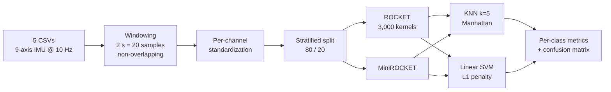

# Robot Arm Anomaly Classification from IMU Time Series

**Classifying 5 types of anomalies on an industrial robotic arm from 2-second windows of 9-axis IMU data, using ROCKET / MiniROCKET random-convolution features with KNN and linear SVM classifiers.**


| Best model | Accuracy | Macro F1 | Earthquake F1 | Magnet F1 |
|---|---|---|---|---|
| **MiniROCKET + linear SVM** | **0.86** | **0.86** | 0.97 | 0.96 |

> 🇪🇸 **Resumen:** Modelo de Machine Learning que reconoce 5 tipos de anomalía (sismo, peso extra, golpe al brazo, golpe a la plataforma e interferencia magnética) en un brazo robótico industrial a partir de 64 303 lecturas de un IMU de 9 ejes. Las señales se cortan en ventanas de 2 s, se transforman con ROCKET/MiniROCKET y se comparan 4 combinaciones de modelo. La mejor (MiniROCKET + SVM lineal) logra un F1 macro de 0.86, y más de 0.95 en las fallas críticas (sismo e interferencia magnética).

---

## Why it matters

Each anomaly calls for a different response from the robot cell: an **earthquake** triggers an emergency stop, **extra weight** requires re-planning the task, **hits** to the arm or platform call for a physical inspection, and **magnetic interference** points to an electromagnetic check. Misclassifying one as another has operational, economic and safety costs, so the goal is a fast classifier that works on short windows of sensor data.

## Dataset

- Public Kaggle dataset of IMU recordings from an industrial robotic arm (6-DOF) in the CASPER testbed (Kayan et al., Cardiff University). <!-- TODO: pegar aquí el link de Kaggle -->
- **64,303 samples** at **10 Hz**, 9 channels: accelerometer (`accX/Y/Z`), gyroscope (`gyroX/Y/Z`), magnetometer (`magX/Y/Z`).
- **5 classes:** `earthquake`, `extra_weight`, `hitting_arm`, `hitting_platform`, `magnet` (moderate imbalance, ~1.4 : 1).

The CSV files are not versioned. See [`data/README.md`](data/README.md) to download them.

## Approach



1. **Windowing:** each class's signal is cut into non-overlapping 2-second windows (20 × 9), giving **3,213 windows**. Short windows keep the decision latency low.
2. **Normalization:** `StandardScaler` per channel.
3. **Split:** stratified 80/20 train/test (`random_state=42`); no oversampling, to keep the physical signals intact.
4. **Features:** [ROCKET](https://arxiv.org/abs/1910.13051) applies thousands of random convolutional kernels and keeps two statistics per kernel (max and PPV); [MiniROCKET](https://arxiv.org/abs/2012.08791) is its faster, almost deterministic variant. No backpropagation is needed.
5. **Classifiers:** KNN (k = 5, Manhattan distance) and a linear SVM with L1 penalty (`LinearSVC`), trained on each feature set → **4 configurations**.
6. **Evaluation:** one-vs-rest accuracy, precision, recall and F1 per class, plus confusion matrices.

## Results

| Configuration | Accuracy | Macro F1 |
|---|---|---|
| ROCKET + KNN | 0.64 | 0.62 |
| ROCKET + SVM | 0.61 | 0.61 |
| MiniROCKET + KNN | 0.76 | 0.74 |
| **MiniROCKET + SVM** | **0.86** | **0.86** |

<p align="center"></p>

**Best model: MiniROCKET + SVM** (test set, 643 windows)

| Class | Precision | Recall | F1 |
|---|---|---|---|
| earthquake | 0.99 | 0.96 | 0.97 |
| extra_weight | 0.76 | 0.91 | 0.83 |
| hitting_arm | 0.78 | 0.76 | 0.77 |
| hitting_platform | 0.79 | 0.77 | 0.78 |
| magnet | 0.99 | 0.93 | 0.96 |

<p align="center"></p>

<details>
<summary>Confusion matrices for the other configurations</summary>

| ROCKET + KNN | ROCKET + SVM | MiniROCKET + KNN |
|---|---|---|
|  |  |  |

</details>

### Takeaways

- **MiniROCKET beats ROCKET** with both classifiers here, and the **linear SVM** makes the most of its larger feature space.
- **Earthquake and magnetic interference**, the most safety-critical classes, are separated almost perfectly (F1 ≥ 0.96): earthquakes show high-energy oscillations in the accelerometer, and magnets show disturbances only in the magnetometer.
- Most remaining errors come from **hitting_arm ↔ hitting_platform** (37 of the 90 test errors): both are short impulsive impacts with similar IMU signatures.

> MiniROCKET is not seeded in the notebook, so the scores shift slightly from run to run. The class presentation reported a macro F1 of 0.84 for the same configuration.

## Limitations and next steps

- **More realistic validation.** Windows are split at random, so neighboring windows from the same recording can land in both train and test. The scaler is also fitted before the split. A split by recording session (or by time) would give a stricter estimate.
- **Reproducibility:** seed MiniROCKET and report mean ± std over several seeds.
- **Separating hits:** try overlapping windows, MultiROCKET, or adding a 1D-CNN to tell `hitting_arm` from `hitting_platform`.
- **Edge deployment:** MiniROCKET + a linear model is light enough to consider running inference on a microcontroller next to the IMU.

## Repository structure

```
├── anomaly_classification.ipynb   # full pipeline, with outputs
├── data/                          # IMU CSVs (not versioned, see data/README.md)
├── docs/presentation.pdf          # final course presentation (Spanish)
├── images/                        # figures used in this README
└── requirements.txt
```

## How to run

```bash
git clone https://github.com/jeanpieroCode/robot-arm-anomaly-classification.git
cd robot-arm-anomaly-classification
python -m venv .venv && source .venv/bin/activate   # Windows: .venv\Scripts\activate
pip install -r requirements.txt
# put the 5 IMU_*.csv files in data/ (see data/README.md)
jupyter notebook anomaly_classification.ipynb
```

## Team

Team project for the Machine Learning course at UTEC (Lima, Peru), taught by Prof. Ariana Villegas.

- **Jean Piero Barboza Santa Cruz** · [LinkedIn](https://linkedin.com/in/jeanpierobarboza)
- Franklin Soncco Machaca
- Piero Sánchez Garay
- Ray Bolaños Aedo
